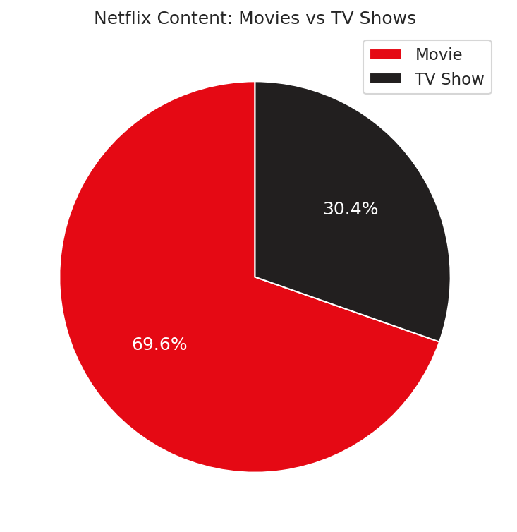
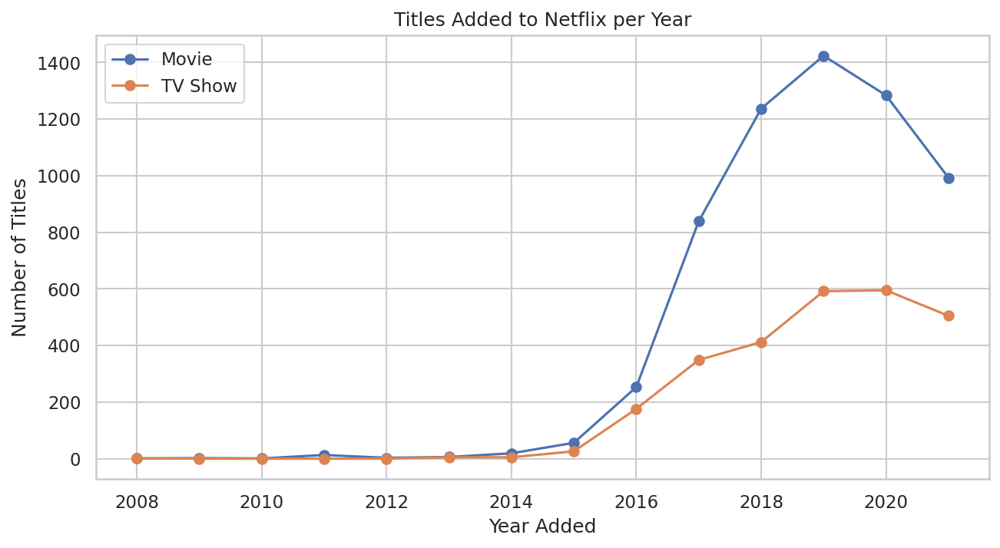
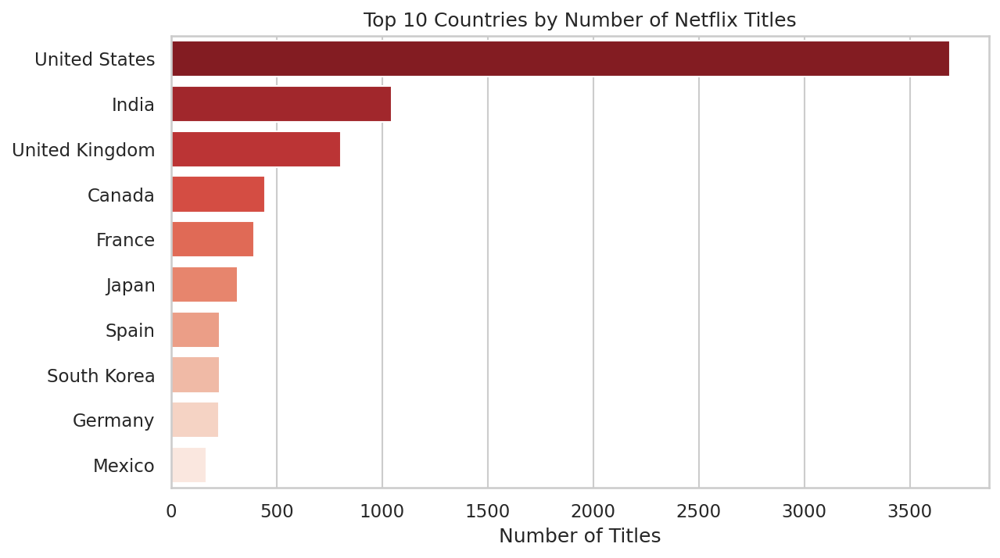
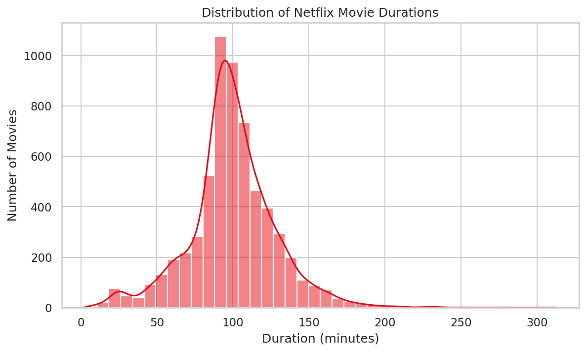
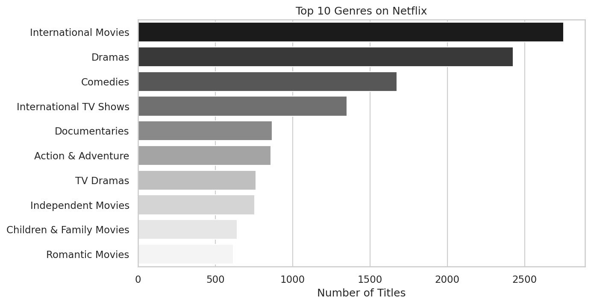

# 🎬 Netflix Movies & TV Shows — Data Visualization

**INFO 5100 · Lab 8** · 

This project explores the Netflix catalog to see what kind of content it offers, how fast the library grew, where the content comes from and how long the movies are. The data is cleaned with **Pandas** and visualized with **Matplotlib** and **Seaborn** in Google Colab.

## 📂 Dataset

[Netflix Movies and TV Shows (Kaggle)](https://www.kaggle.com/datasets/shivamb/netflix-shows): about 8,800 titles with type, title, director, cast, country, date added, release year, rating, duration and genres.

## 🧹 Data Cleaning

- Moved a few durations (e.g. `"74 min"`) that were entered in the `rating` column by mistake
- Converted `date_added` from text to dates and extracted the year
- Filled missing countries with `"Unknown"`
- Split multi-value fields like `"United States, India"` so each country and genre is counted
- Converted movie durations like `"90 min"` to numbers

## 📊 Visualizations

### 1. Movies vs TV Shows (Matplotlib pie chart)

Movies make up about two-thirds of the catalog.

### 2. Titles Added per Year (Matplotlib line chart)

Growth was slow until around 2015, then took off and peaked around 2018–2019. The 2021 dip is mostly because the data ends partway through that year.

### 3. Top 10 Countries (Seaborn bar chart)

The United States leads by a wide margin, followed by India and the United Kingdom.

### 4. Movie Durations (Seaborn histogram)

Most movies run about 90–100 minutes, the standard feature-film length.

### 5. Top 10 Genres (Seaborn bar chart, bonus)

International movies, dramas and comedies are the most common categories.

## ▶️ How to Run

Open the notebook in Colab using the badge above and choose **Runtime → Run all**. The dataset downloads automatically with `kagglehub`, and charts are saved to the `charts/` folder.
